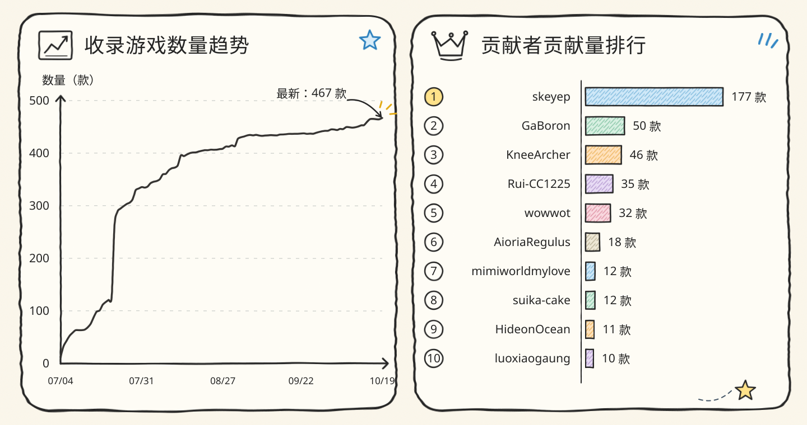

# Steam 成就翻译库

简体中文 | [English](README_EN.md)

社区维护的 Steam 成就翻译数据仓库，保存完整 BIN 及独立翻译 JSON，并提供检索网站，供 SATLI 本体与 SATLI lite 使用。

## 🚀 从这里开始

  
  
  
  

> [!TIP]
> 在 Steam 内下载和显示译本，可使用 [SATLI lite](https://github.com/GaBoron/SATLI-lite)，需要 Millennium 3.5.0 或更高版本，无需安装 SATLI 本体。管理本机 BIN、制作投稿 ZIP 或备份恢复原文件，请使用 [SATLI](https://github.com/GaBoron/SATLI)。本仓库用于浏览译本与投稿。

## 📚 翻译库操作

- **在 Steam 内使用：** 按 [SATLI lite 安装说明](https://github.com/GaBoron/SATLI-lite#安装) 安装插件，在“管理译本”中选择游戏、译本与语言，预览后下载并应用；无需手动下载或替换 BIN。
- **找译本：** 在 [翻译库网站](https://gaboron.github.io/steam-achievement-translation-library/?lang=zh) 搜索游戏名、Steam app ID 或贡献者，也可以按状态和语言筛选。进入游戏详情后，按版本说明选择译本，并留意“可能过期”或“可能不生效”状态。
- **没有译本：** 提交 [翻译请愿](https://github.com/GaBoron/steam-achievement-translation-library/issues/new?template=translation_petition_zh.yml)，填写 App ID、游戏名和目标语言即可，原始 schema ZIP 可选；公开数据可获取时会生成候选 JSON。
- **贡献译本：** 按照 [贡献指南](docs/CONTRIBUTING.md) 提交 [新游戏](https://github.com/GaBoron/steam-achievement-translation-library/issues/new?template=translation_contribution_zh.yml)或 [更新已有文件](https://github.com/GaBoron/steam-achievement-translation-library/issues/new?template=translation_update_zh.yml)。
- **发现问题：** 使用 [文件错误报告](https://github.com/GaBoron/steam-achievement-translation-library/issues/new?template=outdated_report_zh.yml)标记过期或不生效的译本；有新版文件时请直接提交更新。

直接下载文件时，请确认文件名和 app ID 一致。BIN/ZIP 供 SATLI 本体安装或投稿，格式 1 JSON 供现有 SATLI lite 使用，独立格式 2 JSON 需要支持新格式的客户端，不能安装为 BIN；它们不能仅通过修改扩展名互换。BIN 安装、备份与恢复建议交给 [SATLI](https://github.com/GaBoron/SATLI)，避免手工覆盖错误文件。

## 🧩 开发者接入

`index-v2.json` 是公开游戏目录。每个译本位于 `files/<app_id>/<variant_id>/`，保存 BIN 及其格式 1 JSON，或仅保存格式 2 JSON；所有版本统一收录在 `games/variants`，客户端需识别 BIN 与 JSON-only 类型。名称、描述与语言可在网站中预览。

接口字段、下载校验和示例代码见 [数据接入指南](docs/integration.md)，JSON 字段说明见 [翻译 JSON 格式](docs/translation-json.md)。

## 🔄 项目协作

| 项目 | 职责 |
| --- | --- |
| **本仓库** | 保存社区译本、Catalog 和翻译 JSON |
| [Steam 成就翻译管理器](https://github.com/GaBoron/SATLI) | 使用本仓库数据完成扫描、预览、安装、编辑、备份与恢复，并可导出投稿 ZIP |
| [SATLI lite](https://github.com/GaBoron/SATLI-lite) | 在 Steam 内下载 JSON、选择译本与语言、编辑本地文字并应用显示翻译；安装与操作见 [使用说明](https://github.com/GaBoron/SATLI-lite#安装) |
| [Steam Achievement Localizer Skill](https://github.com/GaBoron/steam-achievement-localizer-skill) | 查询本仓库参考译本，研究和制作翻译，输出可由管理器导入或向本仓库投稿的 BIN/ZIP |

偏好独立的本地可视化编辑器时，也可以使用 [PanVena/SteamAchievementLocalizer](https://github.com/PanVena/SteamAchievementLocalizer)。

## 📈 收录统计

## 💬 联系支持

需要帮助时，请发送邮件至 [SATLI.support@proton.me](mailto:SATLI.support@proton.me)。

## ⚖️ 许可证与权利

详见 [LICENSE.md](LICENSE.md)。网站与工作流脚本采用 MIT；贡献者自有翻译部分采用 CC BY 4.0；原始游戏内容、成就文本和 Steam schema 仍归对应权利方所有。
